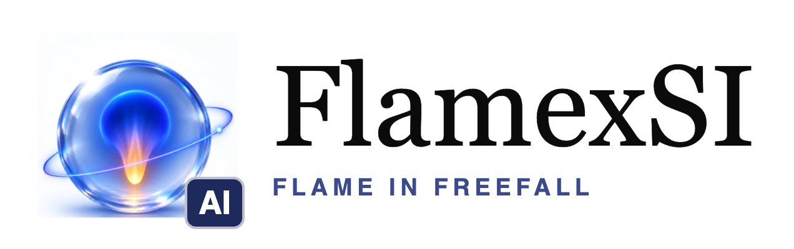
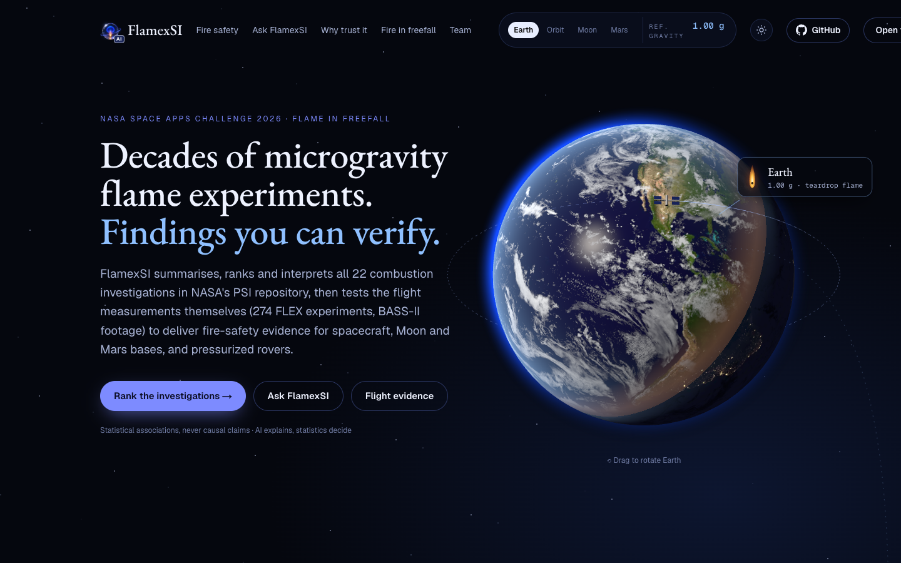
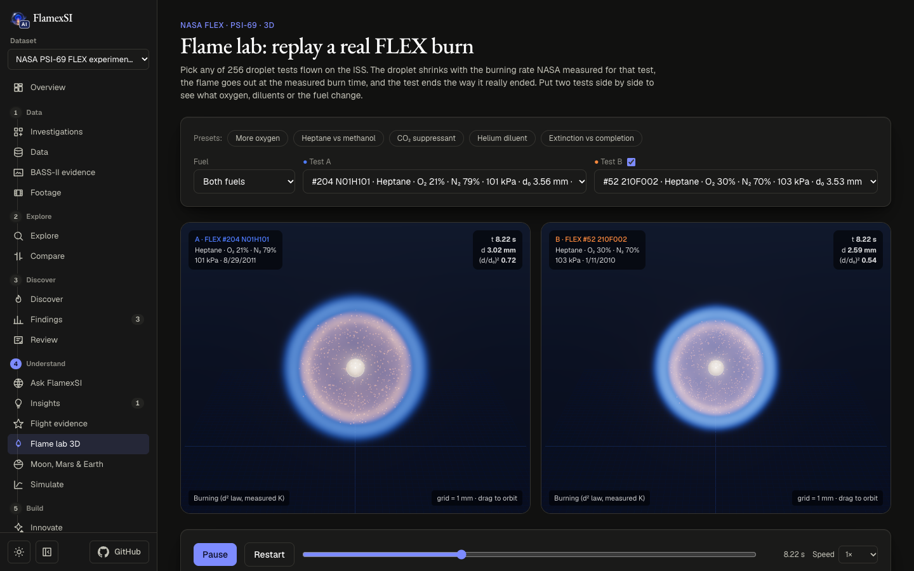
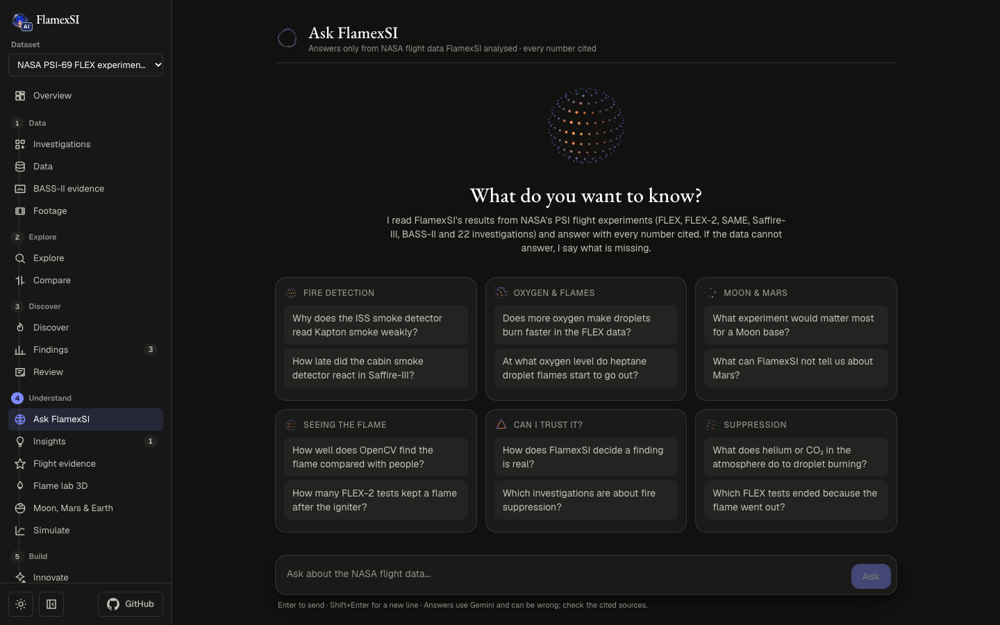
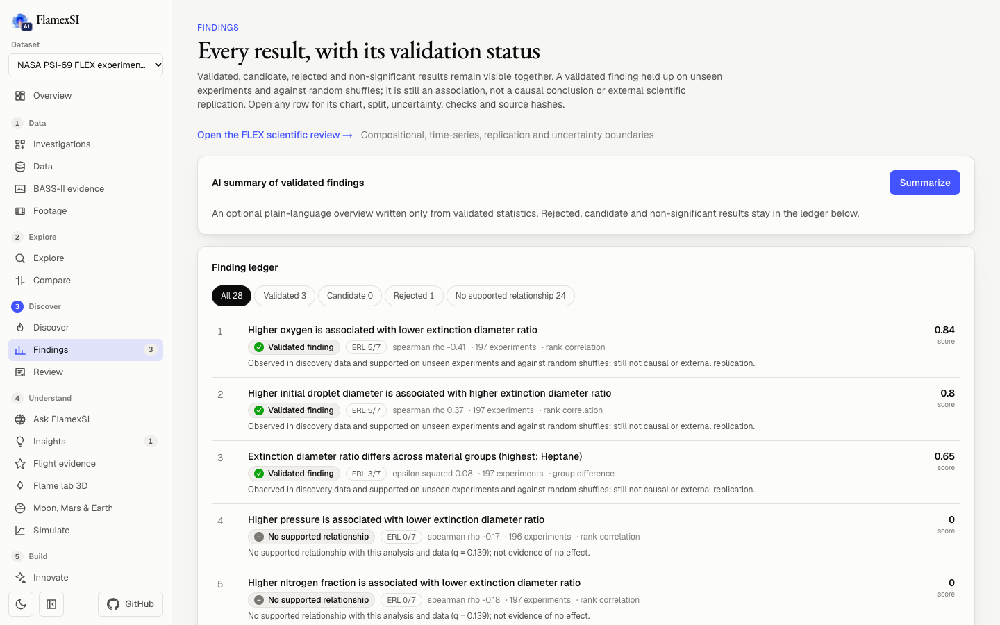
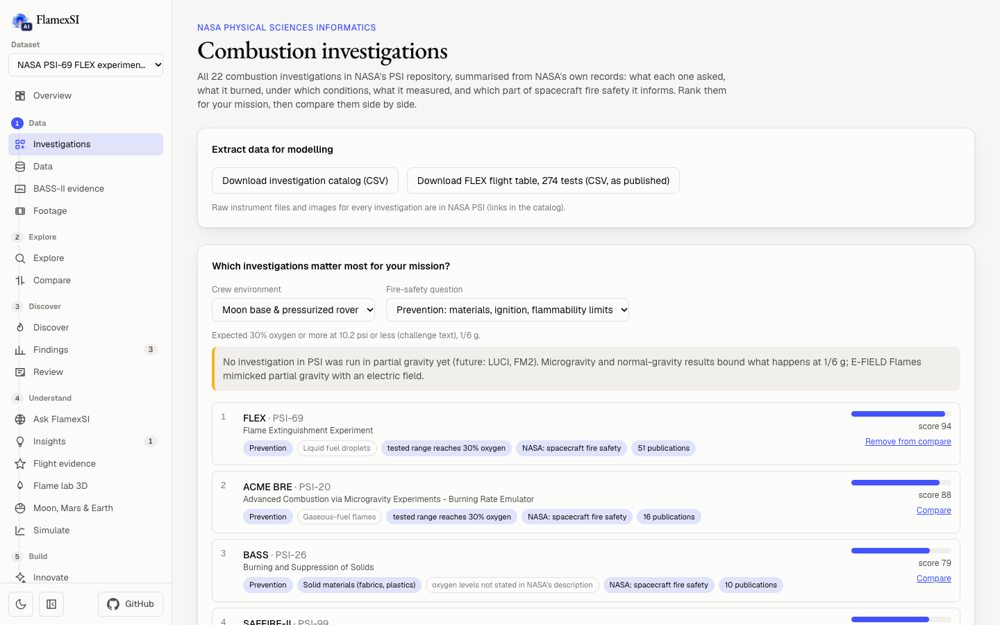

<p align="center">
  <picture>
    <source media="(prefers-color-scheme: dark)" srcset="docs/brand/readme-logo-dark.png">
    
  </picture>
</p>

<h3 align="center">AI-assisted fire-safety evidence from NASA microgravity combustion data</h3>

<p align="center">
  <em>From NASA flight experiments to findings you can verify, with every number traced back to its source.</em>
</p>

<p align="center">
  
  
  
  
  
</p>

<p align="center">
  <a href="https://flamexsi.com"><strong>Live site</strong></a> ·
  <a href="#-features">Features</a> ·
  <a href="#-nasa-data">NASA data</a> ·
  <a href="#-scientific-status">Scientific status</a> ·
  <a href="#-getting-started">Getting started</a> ·
  <a href="AI_USE.md">AI use</a>
</p>

---

<p align="center">
  
</p>

## 📖 About

NASA has flown flame experiments in microgravity for decades. The results live in many
separate investigations, files and formats, so they are hard to find, compare and trust.

**FlamexSI** brings that evidence into one research workspace. It ranks and compares the
combustion investigations in NASA's Physical Sciences Informatics (PSI) repository, then
analyses the flight measurements themselves: 274 FLEX droplet-combustion experiments and
BASS-II flame footage. Every association it reports is first found on one part of the data,
then re-tested on experiments it never saw and against random shuffles, and shown with its
sample size, uncertainty, limitations and source files.

> **Research prototype.** FlamexSI supports researchers and spacecraft fire-safety
> engineers. It is not an operational fire-safety, detection or suppression system, and its
> findings are not a certification of one.

---

## 👥 Team NovaForge

**Pouya Latifiyan** (team owner) · **Alireza Mosavi** · **Fatemeh Iranmanesh** ·
**Mohammad Ali Hatefi** · **Haniyeh Z. Budaqi** · **Fariba Shahrouei**

BASS-II computer vision and models v3 to v6 (`bass-cv/`): Pouya Latifiyan.

---

## ✨ Features

The app follows the research pipeline in five stages: **Data → Explore → Discover →
Understand → Build**.

| | Feature | What it does |
|---|---|---|
| 🗂️ | **Investigations** | All 22 PSI combustion investigations in one place: rank, compare and read them |
| 💾 | **Data** | Loads CSV, TSV, TXT, Excel, JSON and Parquet; keeps the original file byte for byte, standardizes names and units, and reports data quality with a reason for every change |
| 🔍 | **Explore & Compare** | Filter experiments by any variable; see what differs between experiments, with repeated measurements and their spread |
| 🧪 | **Discover** | Finds associations on 70% of the experiments, re-tests them on the 30% it never saw and against random shuffles, and corrects for testing many associations at once |
| 📊 | **Findings & Review** | Every result keeps its status (validated, candidate, rejected, not significant) with its chart, split, uncertainty, third-variable checks and source hashes |
| 💬 | **Ask FlamexSI** | A research assistant: ask in plain language, get answers built only from FlamexSI's NASA results, with every number cited |
| 🔥 | **Flame lab 3D** | Replay a real FLEX droplet burn: the droplet shrinks at the burning rate NASA measured, and the flame goes out at the measured time |
| 🎥 | **Footage & BASS-II evidence** | Turns flame video into measurements with OpenCV, and shows the frozen BASS-II masks and reviewer agreement |
| 🛰️ | **Flight evidence** | NASA FLEX and BASS-II findings, report and mission check |
| 🌗 | **Moon, Mars & Earth · Simulate** | What flight data can and cannot say about partial gravity; flammability by oxygen and gravity, estimated only from loaded data |
| 💡 | **Insights & Innovate** | Findings a researcher reviewed and interpreted, and what an insight could make possible |

<p align="center">
  
  
</p>
<p align="center">
  
  
</p>

---

## 🛰️ NASA Data

All analysed data comes from **NASA Physical Sciences Informatics (PSI)**. No data is
AI-generated.

| Investigation | PSI ID | Used for |
|---|---|---|
| FLEX (Flame Extinguishment Experiment) | PSI-69 · DOI `10.60555/mbq8-0451` | 274 droplet-combustion experiments, statistical discovery, Flame lab 3D |
| FLEX-2 | PSI-68 | Hypotheses (no measured outcomes in the supplied source, so `not_evaluable`) |
| BASS-II | PSI-25 · DOI `10.60555/4qc4-de67` | Flame footage and computer-vision segmentation |
| Saffire-I / II / III | PSI-98, PSI-99, PSI-100 | Spacecraft-scale fire and smoke-detection evidence |
| SAME and SAME-R | PSI | Smoke detection evidence |
| PSI combustion catalogue | 22 investigations | Ranking and comparison |

A clearly labelled synthetic test generator exists only to check the pipeline. Its results
are marked as synthetic everywhere and can never become an insight.

Other sources: NASA planet surface maps (landing page) and background photos from Unsplash
under the Unsplash License (credits in `frontend/public/`).

---

## 🔬 Scientific Status

FlamexSI reports what the data supports, and also where it stops.

### Real FLEX analysis (PSI-69)

The review workspace contains **274 experiments and 44 primary outcomes**: 12 `validated`,
3 `candidate`, 2 `rejected` and 27 `not_significant` under the primary split. `validated`
is an internal statistical status, not independent replication, causal proof or
operational validation. Implemented analysis paths include preregistered replication,
time-series, compositional, uncertainty and scientific-review workflows.

### Real BASS-II computer vision (PSI-25)

`bass-cv/` holds the supervised segmentation workflow for the visibly luminous flame
region. The selected v6 LightGBM pixel classifier uses 74 features and video-grouped model
selection over 15 development videos (the video, not the frame, is the independence unit).

On the reserved confirmation set (B14/B17/B18, eight frames each), with predictions frozen
before annotation, **v6 has zero true-positive pixels on all 24 frames** (TP=0, FP=60,537,
FN=9,218). **This is a failed confirmation, not a successful deployment result.**

Two reviewer annotation sets disagree on visibility in 17 of 24 frames (positive-union
Macro IoU 0.110778, Micro IoU 0.257337). The team reports separate A and B scores; the
frozen v6 predictions reach pooled IoU 0.0271 against A and 0.0337 against B. Reviewer
agreement is not correctness, and no independent-expert or operational-readiness claim is
made. The target is only the visibly luminous region: not a chemical flame boundary,
temperature field, reaction zone or safety instruction.

### Partial gravity

NASA's available PSI combustion evidence has **no direct measurements of fire in partial
gravity**. FlamexSI does not claim validated fire behaviour on the Moon or Mars. The gravity
visuals in the 3D views are illustrative; the site separates measured evidence from
illustrations and lists the questions future partial-gravity experiments must answer.

See [`docs/EVIDENCE.md`](docs/EVIDENCE.md), [`bass-cv/README.md`](bass-cv/README.md) and
[`bass-cv/vision-v6/MODEL_CARD.md`](bass-cv/vision-v6/MODEL_CARD.md) for exact limitations.

---

## 🤖 AI Use

Following the NASA Space Apps rules on AI ("SI"):

- **Ask FlamexSI** and the interpretation helpers use **Google Gemini** to word answers from
  results FlamexSI computed. They never create findings, and answers cite their sources.
- **Statistics, validation and computer vision are not generative AI**: they are ordinary,
  reproducible code (SciPy, scikit-learn, LightGBM, OpenCV).
- Parts of the code, tests and documentation were written with an **AI coding assistant**,
  directed, reviewed and tested by the team.
- The **FlamexSI logo is AI-generated** and always carries a visible **AI** mark.
- **No data is AI-generated.**

Full statement: [AI_USE.md](AI_USE.md).

---

## 🛠️ Tech Stack

| Layer | Technology |
|---|---|
| Backend & API | Python 3.12, FastAPI |
| Data & storage | DuckDB, Parquet, pandas, NumPy |
| Statistics & ML | SciPy, scikit-learn, LightGBM |
| Computer vision | OpenCV |
| Language model | Google Gemini (explains computed results only) |
| Frontend | TypeScript, React, Next.js 16, Tailwind CSS |
| 3D | Three.js (WebGL2, with a 2D fallback) |
| Deployment | Docker, Vercel, DigitalOcean, Nginx, Cloudflare |

---

## 📂 Project Structure

```
backend/      FLEX ingestion, analysis engine, validation, API, scientific review, tests
frontend/     Next.js app: data, findings, assistant, 3D flame lab, simulator, review views
bass-cv/      BASS-II code, compact models, frozen predictions, metrics, review results
services/     The v6 vision model served as its own service
deploy/       Droplet deployment scripts (CI deploys on every push to main)
docs/         Evidence boundaries, delivery notes, screenshots
```

Large raw videos, training caches and fold predictions are intentionally not in GitHub.
The lightweight BASS-II tree is enough to inspect the code and verify the included
model, source and frozen-mask hashes, but **not** to reproduce full training or video
inference.

---

## 🚀 Getting Started

### Run the whole app with Docker

```bash
docker build -t flamexsi .
docker run --rm -p 3000:3000 -v flamexsi-data:/data flamexsi
```

Then open <http://localhost:3000>. On first launch an empty data volume is seeded with
PSI-69. Useful pages: `/review` (real FLEX workspace) and `/bass-review` (frozen BASS-II
images and scores).

Or with Docker Compose:

```bash
docker compose up --build
```

### Local development and checks

Requirements: Python 3.12 and Node.js 22.

```bash
# backend
cd backend
python3 -m pip install -e '.[dev]'
python3 -m pytest -q
python3 -m ruff check .

# frontend
cd frontend
npm ci
npm run lint
npm run typecheck
npm run build
```

Set `GEMINI_API_KEY` in a local `.env` for Ask FlamexSI (without it the app falls back to a
template mode). Never commit `.env` files, API keys, signed storage URLs or cloud
credentials.

### Verify the lightweight BASS-II bundle

```bash
cd bass-cv
python3 -m pip install -r requirements.txt
python3 scripts/verify_lightweight_v6.py
```

This checks the included source frames, 96 frozen prediction masks, model hashes and the
unchanged zero-TP v6 result.

---

## 📜 Disclaimer

FlamexSI was built by Team NovaForge for the **2026 NASA Space Apps Challenge**
("Flame in Freefall"). It uses openly available NASA data. It is **not affiliated with,
endorsed by, or sponsored by NASA**, and it does not use NASA logos or insignia. All
findings are statistical associations for research support and require expert review.

<p align="center">
  <sub>Made by Team NovaForge · NASA Space Apps Challenge 2026</sub>
</p>
